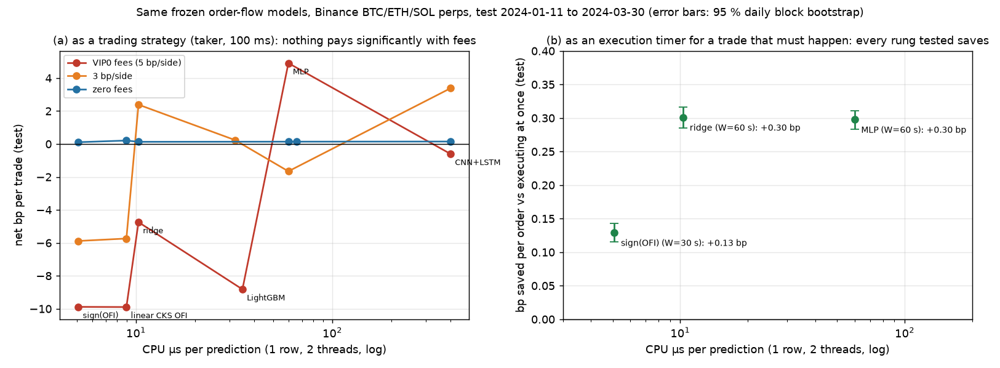
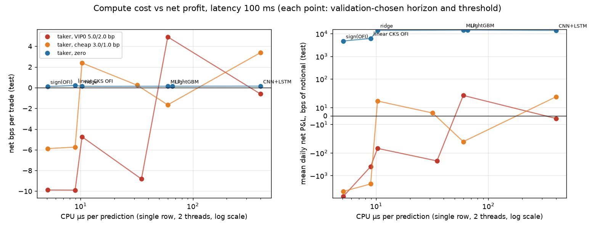
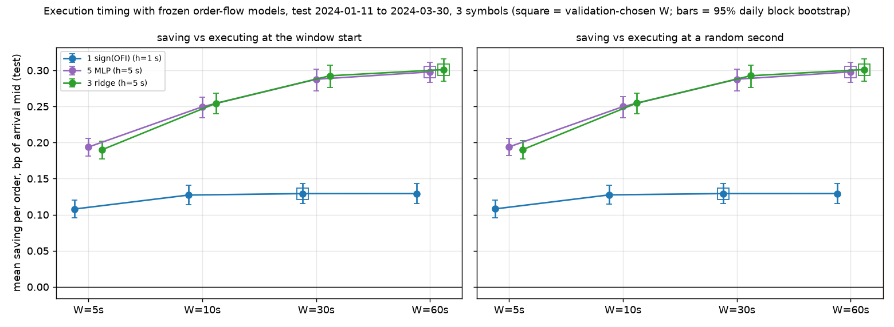
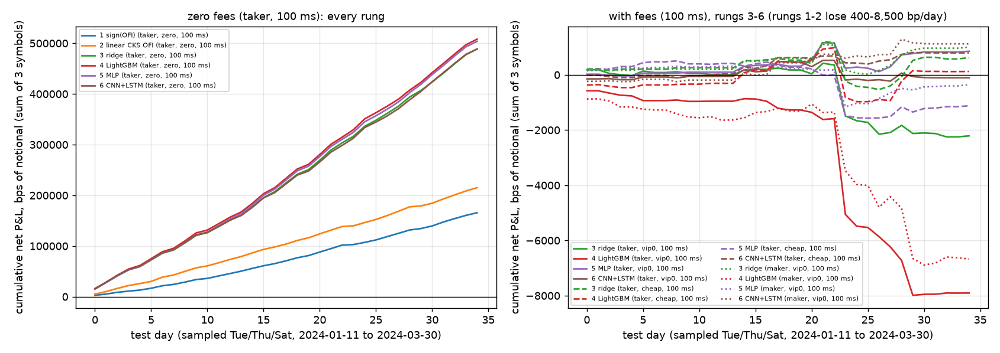

# Order flow after fees: which order-flow model pays on a crypto perpetual?
[](https://github.com/mohymabrouk/order-flow-after-fees/actions/workflows/tests.yml)

**Question.** What is the cheapest order-flow model whose short-horizon forecasts still pay the spread and fees on a real
crypto perpetual?

The study builds a ladder of six models of increasing cost: from the sign of the last order-flow-imbalance bucket (0
parameters) up to a DeepLOB-style CNN+LSTM (7,749 parameters). All six use identical features and targets. They trade
Binance USDT-M BTC, ETH and SOL perpetuals at the real best bid/ask after a latency, and pay Binance fees. Each is scored on
net P&L, on a test period touched once.

A second analysis reuses the same frozen models, with no retraining, to *time* trades that have to happen anyway. There the
fee is paid whatever the timing, so any edge is a saving.

## Headline

**As a trading strategy, no order-flow model pays Binance fees. As an execution timer, the same frozen models save
0.13-0.30 bp on every order, on every test day.**



`results/fig_summary.png` plots CPU µs per prediction against two outcomes on the test period:
- (a) net bp per trade as a stand-alone taker strategy, at three fee levels;
- (b) bp saved per order when the model times a buy or sell that must be done within W seconds.

Error bars are 95 % daily block-bootstrap CIs.

- **Execution timing** (new analysis on the frozen models; design pre-declared in PLAN.md before any number was computed):
  - The rule: execute a must-do buy at the first second the model predicts an up-move (a sell: a down-move), else at the
    window end. The fill is a taker fill 100 ms later.
  - Against executing at once, it saves (test, 300,784 parent orders, 35 days × 3 symbols):
    - **ridge, 72 parameters, ~10 µs, W = 60 s:** **+0.30 bp per order** (95 % CI +0.29 to +0.32);
    - the MLP: +0.30 bp (+0.28 to +0.31);
    - the zero-parameter sign(OFI), W = 30 s: +0.13 bp (+0.12 to +0.14).
  - Every test day was positive for all three. The saving holds on each symbol and on both sides.
  - Against a uniformly random second, the savings are the same.
  - For scale: 0.30 bp is about 6 % of the VIP0 taker fee (5 bp per side). The timed order costs −0.27 bp against the
    arrival mid, i.e. it buys below it on average; executing at once costs +0.03 bp.
  - So for timing, the cheapest model that pays is the zero-parameter sign(OFI), and ridge more than doubles its saving.
    The larger models tested do not beat ridge: the MLP is equal on test, and LightGBM and the CNN were below ridge on
    validation.
- **Zero fees.** The zero-parameter rule (sign of the last 1-second CKS OFI, ~5 µs per prediction) pays the quoted spread.
  - On the 35 sampled test days (2024-01-11 → 2024-03-30, 3 symbols), taker, 100 ms latency, 5 s holds: +0.11 bp per trade
    over 1.5 M trades.
  - Every test day was positive (PSR 1.00, per-rung DSR 1.00).
  - Richer rungs triple the zero-fee daily P&L, through more accurate 1 s forecasts: R² 0.8 % → 2.7-3.5 %, accuracy
    62 % → 68-69 %.
  - But the edge of every rung at horizons ≤ 5 s is only 0.05-0.27 bp per trade before fees. A VIP0 taker round trip costs
    10 bp, so at horizons ≤ 5 s that edge is roughly 40-200 times too small.
- **VIP0 taker fees.** Only selective 5-minute trades come close to the cost.
  - The best test result is the MLP: +4.9 bp per trade on 174 trades, annualised Sharpe 2.2. But PSR is 0.73, DSR is 0.00,
    and the 95 % CI of mean daily P&L is [−51, +91] bp. That is not evidence of a paying strategy.
  - The other five rungs lose 0.6-9.9 bp per trade.
- **Cheaper tier (3 bp per side).**
  - Ridge (+2.4 bp per trade), LightGBM (+0.2) and the CNN (+3.4, PSR 0.93) are positive on test.
  - None is significant; all daily-P&L CIs include 0.
- **Extra compute** buys forecast accuracy, not profit after fees. The frontier is flat: 5 µs and 400 µs per prediction land
  in the same place once fees are paid.

## Main table

Taker, Binance VIP0 fees (taker 5.0 bp / maker 2.0 bp per side), latency 100 ms. Test period: 35 sampled days × 3 symbols.

How each column is defined:
- **Horizon and threshold** were chosen on validation, as a multiple of expected cost.
- **R² / acc:** out-of-sample R² against a zero forecast, and directional accuracy on buckets where the mid moved, both in %.
  They are given at the chosen horizon and at 1 s.
- **Gross:** mid-to-mid move between the two execution times. **Net:** after the spread actually paid and the fees.
- **Sharpe:** annualised from daily P&L (√365, sampled days).
- **PSR:** probabilistic Sharpe ratio against 0.
- **DSR:** deflated Sharpe. The trials are that rung's own validation grid (30 configurations; ridge 90, LightGBM 60, sign 5).
  The DSR over the whole 245-configuration family is 0.000 for every rung here.

| rung | params | µs/pred (1 row / 10k batch) | train s | h | R² / acc at h | R² / acc at 1 s | trades | gross bp | net bp | Sharpe | PSR | DSR |
|---|---|---|---|---|---|---|---|---|---|---|---|---|
| 1 sign(OFI) | 0 | 5.1 / 0.025 | 0 | 300 s | – / 50.7 | – / 62.2 | 30,019 | 0.17 | **−9.89** | −180.6 | 0.000 | 0.000 |
| 2 linear CKS OFI (per symbol) | 6 | 8.9 / 0.027 | 3 | 300 s | −0.01 / 50.6 | 0.76 / 62.2 | 1,424 | 0.14 | **−9.90** | −19.4 | 0.000 | 0.000 |
| 3 ridge (per symbol) | 72 | 10.3 / 0.18 | 9 | 300 s | −0.23 / 50.4 | 2.70 / 68.3 | 466 | 5.88 | **−4.74** | −3.5 | 0.047 | 0.000 |
| 4 LightGBM | 580 | 34.8 / 0.53 | 88 | 30 s | 0.21 / 53.7 | 3.46 / 68.8 | 896 | 1.57 | **−8.82** | −7.0 | 0.000 | 0.000 |
| 5 MLP 23-64-32-5 | 3,781 | 59.7 / 0.19 | 20 | 300 s | 0.50 / 51.2 | 3.30 / 68.5 | 174 | 15.54 | **+4.91** | 2.2 | 0.726 | 0.000 |
| 6 CNN+LSTM (DeepLOB-style) | 7,749 | 400 / 14.2 | 271 | 300 s | 0.47 / 51.1 | 3.13 / 68.7 | 177 | 10.29 | **−0.60** | −0.4 | 0.456 | 0.000 |

Notes on the table:
- **Params.** The linear rungs are fitted per symbol, so 2 or 24 parameters × 3 symbols. LightGBM counts 2·leaves − 1 per tree
  of the h = 30 s booster.
- **Timing.**
  - Measured in Python on 2 threads. Single-row times are dominated by call overhead for the small rungs.
  - LightGBM and the CNN do the most work per call.
  - The MLP and CNN predict all five horizons in one call.
- **Validation net bps** of the chosen configs (in `results/main_table.csv`): −9.95, −10.49, −1.09, −6.20, +6.81, +1.32.
  Only the MLP and the CNN were positive on validation at VIP0.



`results/fig_frontier.png`: CPU µs per prediction against net bp per trade (left) and mean daily net P&L (right, symlog),
taker, 100 ms, at each fee level. At zero fees the curve rises from rung 1 to rung 3, then is flat. With fees it is noise
around a loss.

## Execution-timing overlay (new analysis with the frozen models)

**Status.**
- This analysis was added after the main study's one-shot test.
- It uses the frozen models' cached forecasts (`~/.cache/quant-research/p4/preds/`) and the cached bars. Nothing was retrained
  or refitted, and no main-study number changed.
- The design was written into PLAN.md ("Execution-timing overlay") before any overlay number was computed.
- Choices were made on validation and frozen (`results/overlay_frozen.json`, hash `9b6eb8585fda1aaf`), then test was scored.
  Runs are logged in `results/overlay_test_log.jsonl`.

**Design.**
- **Parent orders.** One buy and one sell of one unit, at a start every 60 s of every (symbol, day); 300,784 orders per
  configuration on test. Each must be executed within a window of W ∈ {5, 10, 30, 60} s.
- **Rule.** At each second t of the window, the order is *favourable* if the frozen model's forecast at t (mid change over the
  next h seconds) is > 0 for a buy or < 0 for a sell. The order is executed at the first favourable second, otherwise at the
  last second of the window.
- **Fill.** As in the main study at 100 ms latency: a taker buys at the ask, or sells at the bid, prevailing 100 ms after
  the decision.
- **Benchmarks:**
  - *now*: execute at the window start, also with 100 ms latency;
  - *random*: a uniformly random second of the window, using its exact expectation.
- **Metric.**
  - Execution price vs the arrival mid, in bp, signed so that positive = saving.
  - Fees are one taker fill in every alternative, so they cancel.
  - CIs come from a 95 % daily block bootstrap (5,000 resamples of the 35 test days); the share of positive days is reported
    alongside.
- **Validation choices.** The grid was 44 configurations: 6 models × forecast horizon h ∈ {1, 5} s × W; sign(OFI) has a
  single h. Per model, (h, W) maximises the mean validation saving against *now*. On test, sign(OFI) and the two best learned
  models are scored.

  | model | best validation (h, W) | validation saving vs now (bp) | scored on test |
  |---|---|---|---|
  | 1 sign(OFI) | (–, 30 s) | +0.101 | yes |
  | 2 linear CKS OFI | (5 s, 30 s) | +0.103 | no |
  | 3 ridge | (5 s, 60 s) | +0.247 | yes |
  | 4 LightGBM | (5 s, 60 s) | +0.233 | no |
  | 5 MLP | (5 s, 60 s) | **+0.252** | yes |
  | 6 CNN+LSTM | (5 s, 60 s) | +0.218 | no |

**Test results** (primary: the validation-chosen h and W):

| model | h | W | orders | saving vs now, bp [95 % CI] | days > 0 | saving vs random, bp [95 % CI] | cost: rule / now, bp vs arrival mid | executed at start | forced at window end | mean delay |
|---|---|---|---|---|---|---|---|---|---|---|
| 1 sign(OFI) | – | 30 s | 300,784 | **+0.129** [+0.116, +0.143] | 100 % | +0.129 [+0.116, +0.143] | −0.103 / +0.026 | 50 % | 0.0 % | 1.1 s |
| 5 MLP | 5 s | 60 s | 300,784 | **+0.298** [+0.283, +0.311] | 100 % | +0.298 [+0.283, +0.311] | −0.272 / +0.026 | 50 % | 0.3 % | 2.6 s |
| 3 ridge | 5 s | 60 s | 300,784 | **+0.301** [+0.285, +0.316] | 100 % | +0.301 [+0.285, +0.316] | −0.275 / +0.026 | 50 % | 0.3 % | 2.6 s |

**By symbol and side** (test, primary configs; saving vs now in bp; `results/overlay_test_breakdown.csv`):

| model | BTC | ETH | SOL | buys | sells |
|---|---|---|---|---|---|
| 1 sign(OFI) | +0.128 | +0.129 | +0.131 (94 % of days > 0) | +0.118 | +0.140 |
| 5 MLP | +0.321 | +0.329 | +0.244 | +0.253 | +0.343 |
| 3 ridge | +0.323 | +0.338 | +0.243 (97 % of days > 0) | +0.295 | +0.308 |

Every 95 % CI in this table excludes 0. Days > 0 is 100 % except where noted.

**By window** (test, descriptive, same run; saving vs now in bp):

| model | W = 5 s | 10 s | 30 s | 60 s |
|---|---|---|---|---|
| 1 sign(OFI) | +0.108 | +0.127 | +0.129 | +0.129 |
| 5 MLP | +0.194 | +0.250 | +0.288 | +0.298 |
| 3 ridge | +0.190 | +0.254 | +0.292 | +0.301 |



`results/fig_overlay.png`: test saving per order by window, against both benchmarks. Squares mark the validation-chosen W.

How to read it:
- **Where the saving comes from.** Half of the orders find a favourable signal at once and execute immediately.
- The other half wait a few seconds, which is when the model predicted an adverse move. They execute after the move, at a
  better price. The timed buy ends up 0.27 bp *below* the arrival mid on average.
- The saving is 0.1-0.3 bp per order: small against a 5 bp fee, but it comes on every order and every day.
- **Models.** The learned models (1 s accuracy ~68 %) beat sign(OFI) (~62 %) by 2.3×. Among learned models, ridge (72
  parameters, ~10 µs) equals the MLP (3,781 parameters, ~60 µs).
- **Window length.** Beyond W ≈ 30 s little is gained, since almost every order finds a favourable second within a few seconds.
- **Benchmarks.** The two agree to the third decimal, as expected when the mid is close to a martingale over a few seconds.

Limits specific to this analysis:
- Orders are one unit at the touch, with no market impact. A large order that sweeps the book or leaks information would see
  a smaller saving.
- Parent orders arrive on a fixed 60 s grid on both sides. Real orders are often correlated with the flow, e.g. buying after
  up-moves.
- The forecasts are used only through their sign, at 1-s granularity.
- **Test runs.** The overlay test was scored twice:
  - The second run (logged with `forced_rerun: true`) only added the per-symbol and per-side decomposition.
  - The frozen configuration was the same in both runs.
  - The pooled results were identical across the two runs (checked).

## Latency × fee sensitivity

Each cell is a separate validation choice of horizon and threshold, frozen before test. Each entry reads: test net bp per
trade [trades] (annualised Sharpe), then the chosen horizon.

**Taker** (pays the spread):

| rung | vip0 / 0ms | vip0 / 100ms | vip0 / 1000ms | cheap / 0ms | cheap / 100ms | cheap / 1000ms | zero / 0ms | zero / 100ms | zero / 1000ms |
|---|---|---|---|---|---|---|---|---|---|
| 1 sign(OFI) | -9.79 [30,026] (-185.8) h=300 | -9.89 [30,019] (-180.6) h=300 | -9.98 [30,019] (-187.1) h=300 | -5.80 [30,026] (-109.9) h=300 | -5.89 [30,019] (-107.6) h=300 | -5.98 [30,019] (-112.1) h=300 | 0.07 [9,011,444] (40.3) h=1 | 0.11 [1,503,802] (53.9) h=5 | 0.08 [291,234] (14.2) h=30 |
| 2 linear CKS OFI | -9.71 [1,424] (-19.3) h=300 | -9.90 [1,424] (-19.4) h=300 | -10.10 [1,424] (-19.0) h=300 | -5.57 [14,604] (-18.4) h=5 | -5.74 [14,372] (-18.4) h=5 | -6.04 [14,372] (-18.3) h=5 | 0.14 [3,816,812] (43.2) h=1 | 0.21 [1,030,690] (66.6) h=5 | 0.12 [577,401] (35.0) h=5 |
| 3 ridge | -5.89 [466] (-4.0) h=300 | -4.74 [466] (-3.5) h=300 | -4.99 [466] (-3.5) h=300 | 1.41 [261] (0.6) h=300 | 2.39 [260] (1.1) h=300 | 1.56 [260] (0.7) h=300 | 0.18 [6,703,306] (58.7) h=1 | 0.13 [3,682,878] (71.7) h=1 | 0.13 [908,429] (42.2) h=5 |
| 4 LightGBM | -8.51 [906] (-7.2) h=30 | -8.82 [896] (-7.0) h=30 | -8.87 [896] (-7.3) h=30 | 0.08 [502] (0.1) h=300 | 0.24 [501] (0.2) h=300 | 0.20 [501] (0.1) h=300 | 0.20 [6,406,120] (54.7) h=1 | 0.14 [3,574,128] (70.5) h=1 | 0.15 [872,882] (52.2) h=5 |
| 5 MLP | 4.37 [174] (2.0) h=300 | 4.91 [174] (2.2) h=300 | 4.05 [174] (1.8) h=300 | -2.21 [681] (-2.7) h=60 | -1.66 [675] (-2.2) h=60 | -1.93 [675] (-2.6) h=60 | 0.20 [6,434,170] (54.9) h=1 | 0.14 [3,560,918] (70.2) h=1 | 0.13 [891,487] (38.5) h=5 |
| 6 CNN+LSTM | -0.85 [177] (-0.5) h=300 | -0.60 [177] (-0.4) h=300 | -0.98 [177] (-0.5) h=300 | 3.22 [235] (4.2) h=300 | 3.38 [235] (4.6) h=300 | 2.83 [235] (3.7) h=300 | 0.19 [7,003,122] (56.1) h=1 | 0.15 [3,262,960] (66.4) h=1 | 0.15 [874,067] (50.1) h=5 |

**Maker variant: OPTIMISTIC fill model.** The order is posted at the touch and filled if a trade prints through it within
h seconds (bucket granularity). The exit is taker.

| rung | vip0 / 0ms | vip0 / 100ms | vip0 / 1000ms | cheap / 0ms | cheap / 100ms | cheap / 1000ms | zero / 0ms | zero / 100ms | zero / 1000ms |
|---|---|---|---|---|---|---|---|---|---|
| 1 sign(OFI) | -8.07 [27,682] (-134.5) h=300 | -7.99 [28,023] (-123.6) h=300 | -8.10 [28,031] (-130.0) h=300 | -5.07 [27,682] (-85.8) h=300 | -4.99 [28,023] (-79.1) h=300 | -5.10 [28,031] (-84.0) h=300 | -1.07 [27,682] (-18.3) h=300 | -0.99 [28,023] (-16.1) h=300 | -1.10 [28,031] (-18.7) h=300 |
| 2 linear CKS OFI | -8.06 [4,943] (-14.2) h=5 | -7.33 [5,997] (-15.3) h=5 | -8.25 [5,374] (-14.7) h=5 | -5.35 [1,276] (-11.8) h=5 | -4.71 [1,496] (-12.8) h=5 | -5.45 [1,347] (-13.1) h=5 | -1.32 [27,738] (-33.4) h=300 | -0.77 [27,789] (-16.7) h=300 | -0.94 [27,772] (-20.3) h=300 |
| 3 ridge | 6.54 [178] (3.2) h=300 | 5.64 [178] (2.7) h=300 | 4.46 [180] (1.9) h=300 | 5.39 [263] (2.8) h=300 | 5.20 [264] (2.6) h=300 | 4.41 [265] (2.2) h=300 | -1.28 [27,812] (-20.3) h=300 | -1.04 [28,181] (-20.2) h=300 | -1.16 [28,093] (-21.3) h=300 |
| 4 LightGBM | -5.58 [1,273] (-7.5) h=300 | -5.23 [1,276] (-7.1) h=300 | -6.38 [1,268] (-7.1) h=300 | 2.16 [538] (2.9) h=300 | 2.38 [537] (3.0) h=300 | -1.13 [536] (-0.7) h=300 | -1.18 [27,355] (-23.0) h=300 | -0.63 [27,932] (-12.5) h=300 | -0.83 [27,891] (-17.7) h=300 |
| 5 MLP | 2.58 [342] (1.8) h=300 | -0.68 [526] (-0.8) h=60 | 2.50 [343] (1.7) h=300 | -0.90 [884] (-1.4) h=60 | -2.17 [1,706] (-4.0) h=30 | -1.06 [889] (-1.7) h=60 | -1.29 [27,179] (-19.7) h=300 | -0.88 [27,581] (-22.1) h=300 | -0.98 [27,608] (-23.8) h=300 |
| 6 CNN+LSTM | 5.24 [200] (4.0) h=300 | 5.59 [201] (4.2) h=300 | 4.01 [199] (2.7) h=300 | -1.89 [1,230] (-2.9) h=300 | -0.98 [1,244] (-1.7) h=300 | 2.34 [457] (2.1) h=300 | -0.87 [27,219] (-19.1) h=300 | -0.80 [27,872] (-19.5) h=300 | -0.98 [27,915] (-22.8) h=300 |

What the two grids say:
- **Latency is what limits the free edge.** At zero fees, the mean daily net P&L (all 3 symbols) at 0 ms / 100 ms / 1 s is:
  - sign(OFI): 18,306 / 4,734 / 644 bp;
  - LightGBM: 36,353 / 14,518 / 3,663 bp.

  Most of the free edge is gone within a second. This is consistent with the short effective horizons Kolm et al. report for
  equities.
- **Fees decide everything else.**
  - Every fee-paying cell with a positive point estimate trades a few hundred times in 35 days, at h = 60-300 s.
  - All such cells have a daily-P&L CI that includes 0: see the bootstrap table in `results/tables.md`.
  - The best are the CNN at 3 bp (PSR 0.93) and the maker CNN at VIP0 (PSR 0.94).
- **Passive entry does not rescue the short horizons.**
  - Entering passively saves the entry fee difference and the half-spread.
  - But a trade-through fill is adversely selected: the price has just moved through the order.
  - So the maker variant loses even at zero fees (−0.6 to −1.3 bp per trade). Validation pushes every maker cell to 300 s holds.

## Per-horizon results (test, taker, 100 ms, threshold chosen on validation per horizon)

Each entry reads: R² % / accuracy % / trades / net bp per trade / annualised Sharpe.

**Zero fees:**

| rung | h=1s | h=5s | h=30s | h=60s | h=300s |
|---|---|---|---|---|---|
| 1 sign(OFI) | – / 62.2 / 4,508,937 / 0.05 / 36.2 | – / 55.9 / 1,503,802 / 0.11 / 53.9 | – / 52.2 / 291,238 / 0.17 / 30.8 | – / 51.5 / 148,029 / 0.18 / 13.5 | – / 50.7 / 30,019 / 0.11 / 2.1 |
| 2 linear CKS OFI | 0.76 / 62.2 / 2,394,962 / 0.11 / 49.6 | 0.19 / 55.8 / 1,030,690 / 0.21 / 66.6 | 0.04 / 52.0 / 227,137 / 0.30 / 40.6 | 0.03 / 51.3 / 93,875 / 0.34 / 42.0 | -0.01 / 50.6 / 24,802 / 0.45 / 10.8 |
| 3 ridge | 2.70 / 68.3 / 3,682,878 / 0.13 / 71.7 | 1.05 / 59.7 / 1,330,593 / 0.24 / 84.8 | 0.05 / 53.3 / 280,670 / 0.26 / 48.7 | -0.11 / 51.9 / 131,329 / 0.26 / 20.8 | -0.23 / 50.4 / 30,006 / 0.13 / 2.7 |
| 4 LightGBM | 3.46 / 68.8 / 3,574,128 / 0.14 / 70.5 | 1.16 / 59.8 / 1,215,059 / 0.27 / 100.4 | 0.21 / 53.7 / 277,755 / 0.31 / 53.7 | 0.11 / 52.5 / 140,698 / 0.32 / 25.8 | 0.10 / 51.2 / 27,420 / 0.46 / 9.3 |
| 5 MLP | 3.30 / 68.5 / 3,560,918 / 0.14 / 70.2 | 1.09 / 59.6 / 1,296,506 / 0.25 / 86.3 | 0.15 / 53.6 / 281,448 / 0.27 / 36.2 | 0.08 / 52.4 / 140,183 / 0.33 / 30.0 | 0.50 / 51.2 / 29,408 / 0.51 / 14.1 |
| 6 CNN+LSTM | 3.13 / 68.7 / 3,262,960 / 0.15 / 66.4 | 1.15 / 59.9 / 1,234,949 / 0.26 / 107.6 | 0.21 / 53.7 / 279,668 / 0.32 / 59.1 | 0.16 / 52.5 / 142,736 / 0.37 / 42.7 | 0.47 / 51.1 / 27,460 / 0.54 / 16.5 |

**VIP0** (a dash means the rung never cleared the cost threshold, so it made no trade):

| rung | h=1s | h=5s | h=30s | h=60s | h=300s |
|---|---|---|---|---|---|
| 1 sign(OFI) | 4,508,937 tr / -9.95 | 1,503,802 / -9.89 | 291,238 / -9.83 | 148,029 / -9.82 | 30,019 / -9.89 |
| 2 linear CKS OFI | 0 tr / – | 0 / – | 0 / – | 0 / – | 1,424 / -9.90 |
| 3 ridge | 0 / – | 13 / -5.47 | 2,086 / -8.89 | 497 / -7.75 | 466 / -4.74 |
| 4 LightGBM | 0 / – | 0 / – | 896 / -8.82 | 1,206 / -9.84 | 926 / -7.91 |
| 5 MLP | 0 / – | 613 / -8.25 | 201 / -0.70 | 563 / -5.54 | 174 / **+4.91** |
| 6 CNN+LSTM | 0 / – | 0 / – | 259 / -9.86 | 453 / -6.72 | 177 / -0.60 |

**Accuracy is not profit** (`results/fig_accuracy_vs_profit.png`):
- The most accurate forecasts on test lose at VIP0: 1 s, 62-69 % directional accuracy, R² up to 3.5 %. Their magnitude never
  reaches the cost, or they lose 10 bp per trade when forced to trade.
- The only positive VIP0 point comes from a 51 % accurate, R² 0.5 % forecast at 5 minutes.
- This is Briola et al.'s point, here measured with explicit fills and fees.

**Edge before fees** (`results/edge_before_fees.csv`), as gross − spread per trade:
- At VIP0, the validation-chosen strategies make 0.10 bp (linear OFI), 0.12 bp (sign), 1.2 bp (LightGBM), 5.3 bp (ridge),
  9.4 bp (CNN) and 14.9 bp (MLP).
- A taker round trip needs more than 10 bp.

**By symbol** (main scenario, net bp per trade [trades]):
- The MLP's VIP0 result comes from ETH (+5.6 [37]) and SOL (+6.7 [103]); on BTC it is −1.2 [34].
- SOL's mean train spread is 0.47 bp, against 0.036 bp for BTC and 0.058 bp for ETH.



`results/fig_cum_pnl.png`: at zero fees (left) every rung earns every test day. With fees (right), the small positive drifts
of rungs 3-6 are wiped out in late February 2024 (test days 22-29, the late-February 2024 rally) for ridge and LightGBM.

## Data

- **Source:** data.binance.vision, USDT-M futures daily `bookTicker` (every best bid/ask change) and `aggTrades`.
  - Each zip was checked against its `.CHECKSUM` (SHA-256), 2026-11-21.
  - Requests used a generic User-Agent.
- **Window:** every day with USDT-M bookTicker files, **2023-05-16 → 2024-03-30**. The S3 listing ends on 2024-03-30, earlier
  than the mid-2024 end the plan had assumed.
- **Symbols:** BTCUSDT, ETHUSDT and SOLUSDT perpetuals.
- **Sampling:** every **Tuesday, Thursday and Saturday**, fixed before any result. That gives 137 days per symbol (411
  symbol-days):

  | split | dates | sampled days |
  |---|---|---|
  | train | 2023-05-16 → 2023-11-21 | 82 |
  | validation | 2023-11-23 → 2024-01-08 | 20 |
  | test | 2024-01-11 → 2024-03-30 | 35 |

  The gap days are 2023-11-22 and 2024-01-09.
- **Volume:** 4.67 billion quote updates and 377 million aggregated trades. 55.3 GB of zips were transferred
  (BTC 24.2, ETH 19.7, SOL 11.4) and deleted after conversion. A full year of the three symbols would be ~120 GB; one BTC day
  is up to 49 M updates.
- **Conversion:** each day became 86,400 one-second bars. A day's zips were deleted only after its parquet passed three checks:
  - quote update count = raw rows;
  - trade count = raw rows;
  - traded quantity = raw total (maximum relative difference 4e-16).
- **Data quality:** ten BTC days have rows out of file order. One of them (2024-02-10) was checked in detail: two ordered
  streams interleaved, all update_ids unique, timestamps monotonic once sorted. The bar builder sorts, so they are handled;
  see PLAN.md.
- **Cache:** `~/.cache/quant-research/p4/`, 5.6 GB in total: bars 1.1 GB, features 3.0 GB, predictions 1.6 GB.

## Method

**Features at the end of bucket t** (bars ≤ t only). There are 23:
- CKS OFI (the sum of e_n over the second), divided by a trailing 300-s mean depth; its 2 lags; and its 5/30/60/300-s sums;
- trade-count imbalance over 1/5/30 s;
- signed volume over depth, 1/5/30 s;
- queue imbalance at the close;
- spread in bps;
- past mid returns over 1/5/30/60/300 s;
- realised volatility over 60/300 s;
- update activity.

Each day is its own session, and the first 300 s are warm-up. A bucket is dropped when the book is crossed or stale (no
update for more than 10 s).

**Targets:** the mid change in bps from the end of bucket t to the end of bucket t+h, for h ∈ {1, 5, 30, 60, 300} s.

**Ladder:**
1. sign of the last OFI bucket;
2. CKS linear OFI regression, one feature, fitted per symbol (CKS estimate one slope per stock);
3. ridge on all features, per symbol;
4. LightGBM, one model per horizon, pooled over symbols;
5. MLP 23-64-32-5, pooled;
6. a DeepLOB-style CNN+LSTM, pooled. It reads the last 30 buckets of 8 per-second order-flow channels, through two temporal
   convolutions and an LSTM(32), into 5 outputs.

Fitting:
- Rungs 2-5 use a seeded 25 % sample of train buckets (5.2 M rows); LightGBM uses 1.5 M of them. The CNN uses 1.5 M windows
  from alternate symbol-days.
- Targets are winsorised at 0.05/99.95 % for fitting only.
- Hyperparameters are chosen by validation R² or loss:
  - ridge alpha from {1, 100, 10⁴};
  - LightGBM leaves from {15, 63}, with early-stopped trees;
  - MLP and CNN epochs, by early stopping.

**Execution:**
- A signal at the end of bucket t is executed after L ∈ {0, 100 ms, 1 s}, at the prevailing best quote. A taker buys at the ask
  and sells at the bid.
- The position is held for h, then closed as a taker at the prevailing quote. Each symbol holds at most one position, of unit
  notional.
- Trade only when |forecast| > m × expected cost, with m from {0.25, 0.5, 1, 1.5, 2, 3}. Expected cost = round-trip fees +
  the symbol's mean train spread. For the maker variant it is maker + taker fee + half the spread.
- Rung 1 has no magnitude, so it trades every non-zero OFI.

**Fees:** Binance USDT-M VIP0 is 0.05 % taker / 0.02 % maker. The cheaper tier is 0.03 % / 0.01 %. Zero is also tested.
- These levels were fixed in the study design on 2026-11-21. Binance's fee page is rendered by JavaScript and could not be
  fetched to re-check them.
- No BNB discount and no funding payments are applied.

**Protocol (no tuning on test):**
- For each rung and each of 18 cells (taker/maker × 3 fee levels × 3 latencies), (h, m) maximises total validation net P&L
  among configs with at least 50 validation trades.
- That configuration was frozen in `results/frozen_config.json` (hash `d0f8794d05315277`).
- The test ran **once**, on 2026-11-22T00:24Z, with code hash `8d8398de5f95ea24`. It is logged in `results/test_log.jsonl`;
  no forced rerun.

**Metrics:**
- Net = direction × (exit − entry)/entry − fee_in − fee_out × exit/entry. Gross is the mid-to-mid move between the execution
  times, so it includes the latency decay.
- Daily P&L = the sum of net bps over the trades entered that day, summed over the 3 symbols. A day with no trades counts as 0.
- Sharpe = daily mean / sd × √365.
- PSR and DSR are Bailey & López de Prado. `sharpe` and `deflated_sharpe` are copied from Alpha Audit
  (`qal/lab/metrics.py`); a test checks they match the originals. For the DSR, the trials and trial variance are as described
  under the main table.
- Turnover = 2 × trades per symbol-day.

## What is new

- **One ladder, one cost basis.** Six model classes, from 0 to 7,749 parameters and 5 to 400 µs per prediction, are scored on
  identical features and targets. Every one goes through the same explicit fills: real Binance best bid/ask after latency, taker
  and maker variants, three fee tiers. The test is frozen and run once. The result is a compute-cost vs net-P&L frontier rather
  than an accuracy league table.
- **CKS used as a forecast.** The CKS relation is contemporaneous in the paper: it explains ΔP over the same 10-s interval.
  Used as a 1-second-ahead forecast on crypto perps, it still carries 0.76 % R² and 62 % directional accuracy. That is worth
  about 0.1-0.2 bp per trade before fees, roughly 1-2 % of a VIP0 round trip.
- **A size for the "accuracy ≠ profit" gap.**
  - The most accurate forecasts (1 s, ~69 %) have an edge about 70 times smaller than VIP0 fees.
  - The few fee-paying test results come from 5-minute, ~51 %-accurate forecasts on a few hundred trades.
  - Those results are not significant once multiple testing (DSR) or day-level uncertainty (bootstrap) is accounted for.
- **The same forecasts are worth more as an execution timer than as a strategy.**
  - Timing a trade that must happen anyway turns a 0.1-0.3 bp per-second edge from useless into a consistent saving. The fee
    is sunk.
  - The frozen ridge saves 0.30 bp per order, with every one of the 35 test days positive.
  - The cost frontier shifts too: the zero-parameter rule already saves 0.13 bp, and a 72-parameter linear model captures all
    of what a neural network does.

## Limits

- **Window and regime.**
  - The bookTicker window is 2023-05-16 → 2024-03-30 only.
  - The test is 35 sampled days in Q1 2024, one strongly trending regime that includes the spot-ETF launch period.
  - The 2024-06 → 2026-10 extension (trades + bookDepth only) was **not run**: see Deviations.
- **Sampling.**
  - 3 of 7 days are kept, and each day is an independent session.
  - Sharpe is annualised over sampled days.
  - Validation has only 20 days. Validation Sharpe ratios are therefore noisy, which inflates the trial variance and drives
    every fee-paying DSR to ≈ 0.
- **Fill model.**
  - Trades are unit size at the touch, with no queue position, no market impact, and no partial fills or rejects.
  - Quotes are sampled only at the 1-s bucket close and close + 100 ms. Latency is a fixed delay.
  - Maker fills are judged at bucket granularity. At 100 ms latency, up to 100 ms of trades from before the order was posted can
    count. This is optimistic, although the trade-through rule also builds in adverse selection.
  - Zero-fee results are a frictionless upper bound. They assume millions of trades a day with no capacity or impact limit.
- **Costs.**
  - Fee levels were fixed in the design and not re-verified on Binance's site.
  - Funding is ignored (holds are ≤ 5 min; funding is charged every 8 h).
  - Expected cost uses the mean train spread, not the live spread.
- **Models.**
  - Models are fitted once on 2023-05 → 2023-11, with no refits.
  - Deep and tree rungs are pooled across symbols. Small training budgets were used for the 2-core limit.
  - The "DeepLOB-style" rung is a small CNN+LSTM on order-flow series, not the original DeepLOB on 10 raw book levels.
- **Information set.** Level 1 only. OFI is single-level CKS; multi-level OFI is not possible with bookTicker.

## Simplifications and deviations (all logged in PLAN.md, "Changes during the build")

Data and scope:
1. The bookTicker window ends **2024-03-30**; the plan had assumed mid-2024.
2. Sampling is **Tue/Thu/Sat** (3 days a week), not 2. Total transfer was 55.3 GB, under the 60 GB raw budget; at most two days of zips
   (≤ 1 GB) were on disk at once.
3. **The trades + bookDepth extension (2024-06 → 2026-10) was not done.** It was optional. Without L1 quotes it cannot measure
   the spread, which the question is about, and it would have pushed transfer past the budget.

Design:

4. The threshold grid gained a **0.25×** multiple after the thin slice and before any validation run. At 1× cost no forecast
   ever traded at VIP0.
5. The linear rungs (CKS OFI, ridge) are **fitted per symbol**. When pooled, one slope cannot fit tick sizes in bps that differ
   by more than 10× across symbols. This was decided from validation R² before any trading simulation.
6. **The CNN epoch cap was raised from 3 to 8**: its validation loss was still falling. Early stopping kept epoch 3 of 4;
   the MLP kept epoch 2 of 3.
7. **DSR is reported two ways**, plus PSR. The family is either the rung's own grid (main column) or all 245 configs of the
   cell. In both, the trial variance comes from validation configs with at least 50 trades. This was decided after validation
   and before test, because the all-rung family variance is dominated by sign(OFI)'s extreme negative Sharpes.

Implementation:

8. `download` fuses download and bar building per day, so zips never accumulate. `build` makes features from the verified bars.
9. The single-row µs of the per-symbol linear rungs is timed on one symbol's model, as a live per-symbol process would call it.
   This was a re-timing after validation; a check confirmed the refitted models are bit-identical to the ones validated.
10. After the test run, only `report.py` changed (a PSR column and figure layout). The current tree therefore hashes
    differently from the logged code hash.
11. The "done" line in `test_log.jsonl` repeats the start timestamp (a cosmetic bug left as is, so the tested code stays
    unchanged). Its duration is in `seconds` (291 s).
12. Training sizes: 25 % of train buckets for rungs 2-5, 1.5 M rows for LightGBM, 1.5 M windows for the CNN. Early-stopping
    patience is 1.

Execution-timing overlay (added 2026-11-22, after the main test):

13. **It is a new analysis.** It reuses the frozen models' cached forecasts, with no retraining. Its design was pre-declared in
    PLAN.md before any overlay number was computed. Its choices were made on validation and frozen
    (`overlay_frozen.json`, `9b6eb8585fda1aaf`) before its test was scored.
14. **The overlay test was run twice.**
    - The first run (code hash `e3450dac1864daaf`) produced the primary table.
    - A `--force` rerun (code hash `f40eac6c2d93ebb5`, logged) added only the per-symbol and per-side decomposition, with the
      same frozen configuration and identical pooled results.
    - After that, only report and figure code changed (the summary figure).
15. The validation selection favours the longest window offered (60 s for the learned models), because more time can only add
    options. The by-window table shows the whole test curve.

## Literature (verified by me, 2026-11-21; only these points are cited)

- Cont, Kukanov & Stoikov, "The Price Impact of Order Book Events", *J. Financial Econometrics* 12(1):47-88, 2014
  (arXiv 1011.6402).
  - e_n and OFI_k are defined on p.4.
  - ΔP_k = β·OFI_k + ε_k (eq. 2), with β = c/AD^λ (eq. 3).
  - Data: TAQ, April 2010, 50 stocks, 10-s grid. The relation is contemporaneous.
- Kolm, Turiel & Westray, "Deep order flow imbalance: Extracting alpha at multiple horizons from the limit order book",
  *Mathematical Finance* 33(4):1044-1081, 2023.
  - 115 Nasdaq stocks.
  - "models trained on order flow significantly outperform most models trained directly on order books".
  - The effective horizon is "approximately two average price changes".
- Zhang, Zohren & Roberts, "DeepLOB: Deep Convolutional Neural Networks for Limit Order Books", *IEEE Trans. Signal Processing*
  67(11), 2019 (arXiv 1808.03668). It uses CNN filters plus an LSTM, on one year of LSE quotes.
- Briola, Bartolucci & Aste, "Deep limit order book forecasting: a microstructural guide", *Quantitative Finance*
  25(7):1101-1131, 2025 (arXiv 2403.09267).
  - "high forecasting power does not necessarily correspond to actionable trading signals".
  - "traditional machine learning metrics fail to adequately assess the quality of forecasts".

## How to run

```bash
git clone https://github.com/mohymabrouk/order-flow-after-fees.git
cd order-flow-after-fees
uv sync                                   # Python 3.12, CPU torch
export PYTHONIOENCODING=utf-8
.venv/Scripts/python -m ofp.cli download  # ~1.5 h, resumable per day; 55 GB transferred, <=1 GB of zips on disk at a time
.venv/Scripts/python -m ofp.cli build     # features + targets (~1 min)
.venv/Scripts/python -m ofp.cli train     # all rungs (~10 min on 2 cores) -> models/, results/train_info.json
.venv/Scripts/python -m ofp.cli validate  # validation forecasts + 18-cell simulation grid (~15 min)
.venv/Scripts/python -m ofp.cli freeze    # choose on validation, write frozen_config.json + hash
.venv/Scripts/python -m ofp.cli test      # once (~5 min); a rerun needs --force and is logged
.venv/Scripts/python -m ofp.cli report    # results/tables.md, CSVs, figures
# execution-timing overlay (uses the frozen models' cached forecasts; seconds)
.venv/Scripts/python -m ofp.cli overlay_validate  # 44-config grid on validation, choose + freeze overlay_frozen.json
.venv/Scripts/python -m ofp.cli overlay_test      # once; a rerun needs --force and is logged in overlay_test_log.jsonl
.venv/Scripts/python -m ofp.cli overlay_report    # overlay_tables.md, fig_overlay.png, fig_summary.png
.venv/Scripts/python -m pytest            # 19 tests
```

Every process pins OMP/MKL/OpenBLAS/Polars to 2 threads; torch and LightGBM also use 2 threads. Caches go to
`~/.cache/quant-research/p4/`. `scripts/thin_slice.py` is the first end-to-end slice: 6 BTC days, linear OFI, taker simulation.

**Tests** (`tests/`, 19 pass):
1. CKS OFI on a hand-made update sequence;
2. targets strictly in the future;
3. taker fills at ask/bid after each latency on a toy book, plus the maker trade-through rule;
4. fee and P&L accounting on a toy trade list;
5. leak test: perturbing raw quotes and trades after bucket t leaves features and every rung's forecasts at t unchanged;
6. `sharpe` and `deflated_sharpe` equal Alpha Audit's on fixed inputs (the original source is executed in isolation, not
   imported);
7. bucketing loses no trades, including trades on bucket boundaries;
8. overlay (`test_overlay.py`):
   - toy-book fills: buy at ask and sell at bid 100 ms after the decision, forced end-of-window execution, both benchmarks,
     invalid rows never favourable;
   - leak tests: perturbing forecasts and quotes after decision row t, or raw quotes and trades after the close of t, leaves
     every decision up to t, and every fill priced before close(t), unchanged.

## Files

The `results/` folder:

| file | contents |
|---|---|
| `tables.md` | every table, including the daily-P&L bootstrap CIs and the forecast metrics |
| `main_table.csv` | the main table |
| `sensitivity_taker.csv`, `sensitivity_maker.csv`, `sensitivity_long.csv` | latency × fee sensitivity |
| `test_results.csv` | all 108 frozen cells on test |
| `test_per_horizon.csv` | per-horizon test results |
| `test_forecast_metrics.csv`, `val_forecast_metrics.csv` | forecast R² and accuracy |
| `test_daily_pnl.csv`, `daily_pnl_bootstrap.csv` | daily P&L and its bootstrap CIs |
| `edge_before_fees.csv` | pre-fee edge per trade |
| `validation_grid.csv` | 2,790 validation simulations |
| `frozen_config.json`, `frozen_selections.csv` | the frozen configuration |
| `train_info.json` | params, timing, hyperparameter grids, epochs |
| `train_spreads.json` | mean train spread per symbol |
| `test_log.jsonl` | the one-shot test log |
| `thin_slice.csv` | the thin-slice output |
| `overlay_tables.md` | all overlay tables, including the full validation grid |
| `overlay_validation.csv` | the 44 overlay validation configurations |
| `overlay_frozen.json` | the frozen overlay choices |
| `overlay_test.csv`, `overlay_test_by_window.csv`, `overlay_test_breakdown.csv` | overlay test results |
| `overlay_test_log.jsonl` | the overlay test log |
| `fig_*.png` | figures |

Elsewhere:
- Code: `src/ofp/` — config, bars, download, features, models, sim, metrics, pipeline, report, overlay, cli.
- Data manifest: `~/.cache/quant-research/p4/manifest.csv`, with per-day raw sizes and the bar verification counts.
